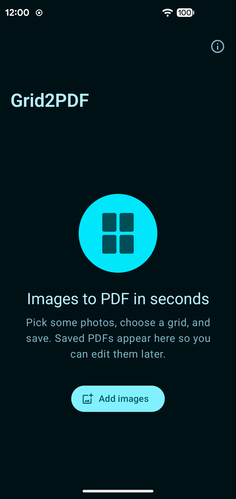
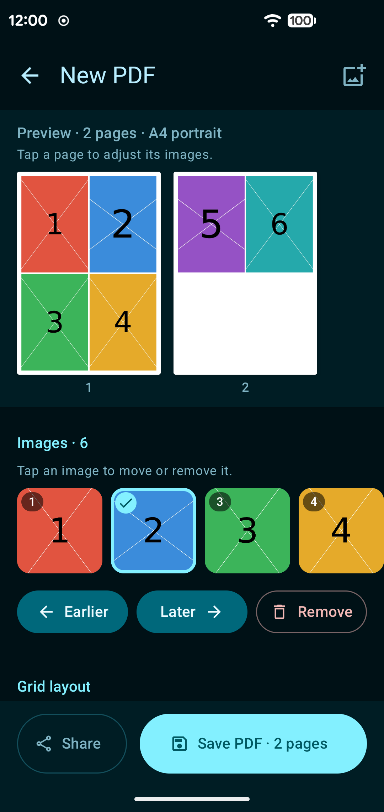
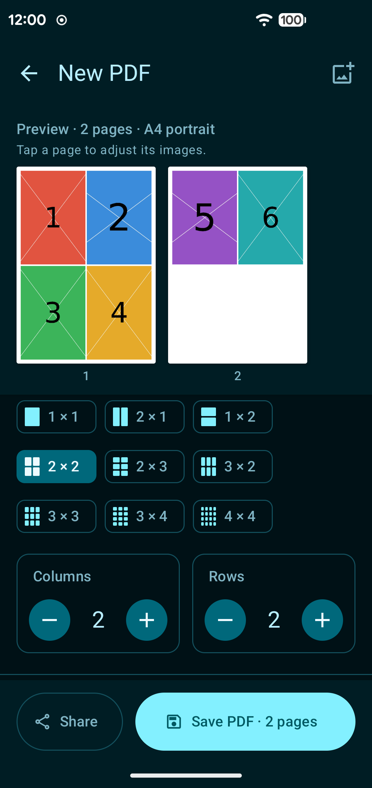
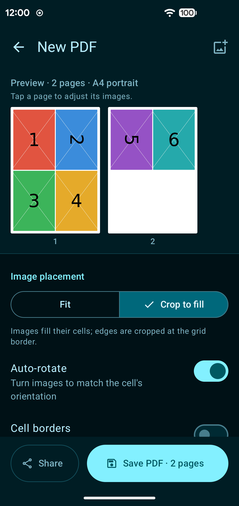
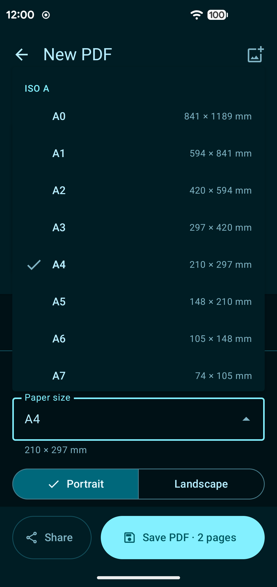
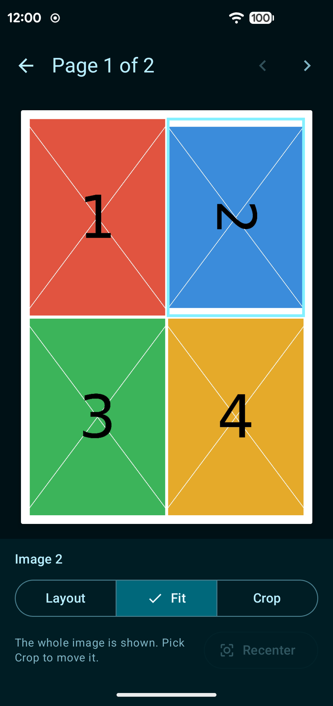
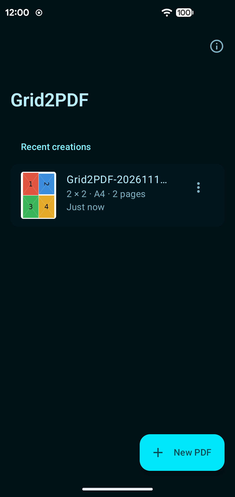

# Grid2PDF

Grid2PDF is a small Android app that turns photos into PDF pages using grid layouts. Pick some photos, choose how many go on a page, and save.


## Screenshots

<p>
  
  
  
  
  
  
  
</p>

## Features

- Any grid from 1x1 to 6x6, with fit or crop-to-fill placement, auto rotate and optional cell borders
- Set fit or crop for each image on its own, and drag a cropped image to choose what shows in its cell
- 32 paper sizes (ISO A/B, North American, JIS and photo sizes), portrait or landscape
- Margin and spacing sliders, three quality levels, and a live page preview that stays pinned at the top
- Share photos into Grid2PDF straight from your gallery
- Saved PDFs appear on the home screen and can be reopened, edited and saved again

## Privacy

Grid2PDF works fully offline. It doesn't request the internet permission and has no ads, analytics or tracking. Photos are picked through the system photo picker, so the app only sees the ones you choose.

## Requirements

Android 9 (API 28) or newer.

## Building

You need JDK 17 and the Android SDK. Point `local.properties` at your SDK (Android Studio does this for you) or set `ANDROID_HOME`.

```bash
git clone https://github.com/nikhil-anilkumar/Grid2PDF.git
cd Grid2PDF
./gradlew assembleDebug        # debug APK, package com.grid2pdf.app.debug
./gradlew testDebugUnitTest    # unit tests
./gradlew assembleRelease      # release APK (unsigned)
```

## Contributing

Bug reports and pull requests are welcome on [GitHub](https://github.com/nikhil-anilkumar/Grid2PDF). If you're planning something big, [open an issue](https://github.com/nikhil-anilkumar/Grid2PDF/issues) first so we can talk it through.

## License

Grid2PDF is released under the [MIT License](LICENSE). Copyright (c) 2026 Nikhil Anilkumar.

The libraries it uses (AndroidX, Jetpack Compose, Kotlin and kotlinx.coroutines) are under the Apache License 2.0.
